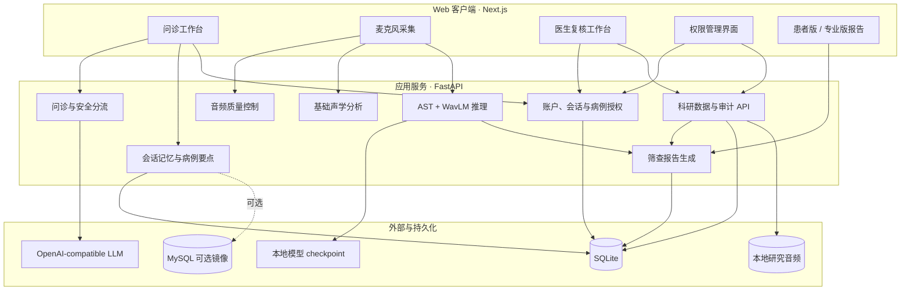

# VoiceScope-Agent

> 面向嗓音疾病筛查、分诊与临床决策支持的多模态医疗智能体

[](https://nextjs.org/)
[](https://fastapi.tiangolo.com/)
[](https://www.python.org/)
[](https://www.typescriptlang.org/)
[](#项目边界与医疗声明)

VoiceScope-Agent 是为第十二届中国研究生智慧城市技术大赛开发的智能嗓音问诊与科研管理原型。项目围绕“先问诊、再采集、后分析、可追溯、由医生复核”的临床工作流，将结构化问诊、大语言模型、六元音嗓音采集、音频质量控制、基础声学分析、AST + WavLM 研究模型和科研数据管理整合到同一平台。

本项目不是通用聊天机器人，也不将模型输出作为临床确诊结果。系统面向嗓音与耳鼻喉相关场景提供健康科普、风险提示和辅助分流，并保留人工纠正、来源事件和模型版本信息，以支持后续研究验证。

> **使用前请自行配置 API。** 仓库不提供 DeepSeek 或其他服务商的 API Key，也不提供可直接使用的模型账户。请在本机配置服务地址、密钥和模型名称；示例文件中的这三个字段默认留空。仓库仅包含代码、配置模板及说明，不包含本地用户、患者、录音、数据库和私人参赛附件。

## 免安装公共入口：浏览器本地版

访问 **[VoiceScope 浏览器本地版](https://2015105076.github.io/VoiceScope-Web/)**，无需注册或安装 Python。

- 病例、结构化问诊、补充说明、备注和六元音录音仅保存在访问者当前浏览器的 IndexedDB 中，不上传到 GitHub 或平台服务器。
- 支持录音、导入音频、回放、时长/电平/削波技术提醒、HTML 个人记录导出，以及包含原始录音的 JSON 备份与恢复。
- 本地问诊向导使用固定问题，不调用第三方 API；现有 Python AST + WavLM 疾病模型、医生复核与多账户管理暂不在浏览器版中提供，不生成疾病预测或诊断报告。
- 本地数据库未额外加密，也没有账户隔离，请使用私人设备并保护系统账户。更换设备、浏览器或清理网站数据可能丢失记录，请定期导出并妥善保管备份。
- 公开网页只包含静态页面和程序资源。访问网页仍会向 GitHub 请求这些资源，托管服务可能记录 IP 等常规访问信息；问诊与录音不随请求发送。

浏览器版发布在独立的 [VoiceScope-Web 静态仓库](https://github.com/2015105076/VoiceScope-Web)，本仓库保留原本机完整平台。下面的 API、账户和后端安装说明适用于完整版。

浏览器版检查与构建（Node.js 24）：

```bash
npm ci
npm run test:browser
npm run lint
npm run build:browser
```

构建在独立临时目录运行，不复制本机 `.env`、后端或患者数据；输出位于被 Git 忽略的 `out/`。发布物的 HTML 禁止网络连接（`connect-src 'none'`），仅允许本站静态程序及本地音频回放。浏览器版不读取完整版的本机数据库，两个版本的数据需要分别管理。

## 目录

- [项目亮点](#项目亮点)
- [2026-09-14 功能更新](#2026-09-14-功能更新)
- [系统工作流](#系统工作流)
- [当前功能](#当前功能)
- [系统架构](#系统架构)
- [技术栈](#技术栈)
- [快速开始](#快速开始)
- [模型配置](#模型配置)
- [数据存储与 MySQL](#数据存储与-mysql)
- [API 概览](#api-概览)
- [测试与质量检查](#测试与质量检查)
- [项目结构](#项目结构)
- [安全与隐私](#安全与隐私)
- [路线图](#路线图)
- [项目边界与医疗声明](#项目边界与医疗声明)

## 2026-09-14 功能更新

本次更新补齐了从模型筛查到临床复核、报告交付和权限治理的闭环：

1. **医生复核工作台**：提供按状态分组的待办队列、患者与问诊摘要、六元音录音安全回放、模型结果与检查资料查看，以及追加式医生意见和版本留痕。
2. **患者版 / 专业版筛查报告**：报告锁定对应的分析请求，呈现采集质量、结果边界、下一步建议、复核状态和模型版本；专业版进一步包含概率分布、声学指标、检查、人工纠正和复核详情，并支持打印、另存为 PDF 或下载 HTML。
3. **账户权限与授权管理**：新增患者、医生、管理员三类角色，采用 HttpOnly Cookie、CSRF 防护和病例级授权；支持患者同意/撤回、医生授权/撤回、账户停用和实名访问审计。

上述能力均已纳入后端自动化测试、前端静态检查和生产构建验证。真实试点部署仍须启用 HTTPS、安全 Cookie，并落实伦理审批、数据保留和备份加密策略。

## 项目亮点

### 1. 面向真实问诊流程，而非一次性分类

系统围绕患者级会话组织信息，逐步补全主要症状、持续时间、症状模式、吸烟史和饮酒史。每项信息均保留来源证据，短回答、补充说明和后续纠正可以在同一会话中持续合并。

### 2. 六元音患者级嗓音建模

研究模型同时接收普通话六个持续元音 `/a/`、`/o/`、`/e/`、`/i/`、`/u/`、`/ü/`：

- AST 分支提取时频表征；
- WavLM 分支提取自监督语音表征；
- 元音级融合层整合两类特征；
- 注意力池化生成患者级表示；
- 分类头输出研究标签、概率分布及各元音注意力权重。

### 3. 将采集质量与疾病表现解耦

在模型推理前，系统独立检查录音时长、有效发声、近静音、削波、录音电平和可评估的背景噪声。质量控制不会因为 Jitter、Shimmer、嘶哑、气息声或周期性不足等潜在病理表现直接拒绝样本。

### 4. 先给可解释指标，再进入研究筛查

单段 `/a/` 可计算最长发声时间（MPT）、基频、Jitter、Shimmer、相对强度和信号类型。基础声学测量与疾病分类分开呈现，便于使用者理解结果来源和适用边界。

### 5. 可追溯的人机协同

研究模型输出不会被人工反馈覆盖。医生或研究人员可以追加纠正标签和备注，系统同时保留：

- 原始模型请求与预测；
- 人工纠正记录；
- 信息来源与时间；
- 模型版本和实验运行信息；
- 数据完整性检查及审计事件。

### 6. 面向安全分流的约束

系统限制问答范围为嗓音及耳鼻喉相关问题；检测到呼吸困难、持续大量出血、意识异常或症状快速加重等危险信号时，优先提示线下急诊或专科评估。

## 系统工作流

```mermaid
flowchart LR
    A[患者登记] --> B[结构化问诊]
    B --> C{危险信号}
    C -- 是 --> D[紧急就医提示]
    C -- 否 --> E[六元音采集]
    E --> F[逐元音质量控制]
    F -- 不合格 --> E
    F -- 合格 --> G[/a/ 基础声学分析]
    G --> H[AST + WavLM 研究筛查]
    H --> I[概率与注意力结果]
    I --> J[患者版筛查报告]
    I --> K[医生复核与人工纠正]
    K --> L[专业版筛查报告]
    K --> M[检查、随访、标签与科研导出]
    N[账户、同意与病例授权] -. 权限控制 .-> A
    N -. 权限控制 .-> K
    N -. 访问审计 .-> M
```

完整设计采用分阶段诊疗思路：

1. **Stage 1：门诊前 / 基层筛查**——病例信息、症状问诊与六元音嗓音分析；
2. **Stage 2：喉镜后辅助诊断**——计划接入 WLB/NBI 喉镜模型，并与病史和 Voice AI 结果进行患者级融合。

> 当前仓库已实现 Stage 1 的核心交互与科研数据链；WLB/NBI、Clinical RAG 和完整多模态融合仍在路线图中。

## 当前功能

| 模块 | 功能 | 状态 |
| --- | --- | --- |
| 患者登记 | 姓名、年龄、性别、地区和主诉登记 | 已实现 |
| 结构化问诊 | 症状、病程、模式、吸烟史、饮酒史补全 | 已实现 |
| 流式对话 | 对接 OpenAI-compatible API，以 SSE 返回回答 | 已实现 |
| 安全分流 | 服务边界、危险信号优先响应、停止继续采集 | 已实现 |
| 会话管理 | 历史检索、恢复、完成、删除、上下文摘要 | 已实现 |
| 六元音录音 | 浏览器录制或上传 `/a o e i u ü/` | 已实现 |
| 音频质量控制 | 时长、有效语音、静音、削波、噪声和电平检查 | 已实现 |
| 基础声学分析 | MPT、F0、Jitter、Shimmer、dBFS、信号类型 | 已实现 |
| 嗓音研究模型 | AST + WavLM 六元音患者级推理 | 已实现，需另配 checkpoint |
| 人工纠正 | 追加医生纠正且保留原预测 | 已实现 |
| 医生复核工作台 | 待办队列、问诊摘要、录音回放、检查查看、意见与状态留痕 | 已实现 |
| 筛查报告 | 患者版与专业版，包含采集质量、结果边界、建议、复核状态和模型版本 | 已实现 |
| 账户与授权 | 患者/医生/管理员角色、病例级授权、同意管理、Cookie/CSRF 与访问审计 | 已实现 |
| 科研管理 | 标签、检查、随访、模型版本、实验登记 | 已实现 |
| 科研导出 | 管理员权限控制的去标识化或含身份 CSV/JSON 导出，并记录审计轨迹 | 已实现 |
| MySQL 镜像 | SQLite 主数据的可选持久化镜像与迁移 | 已实现，可选 |
| WLB/NBI 喉镜分析 | 白光与窄带成像病灶识别 | 规划中 |
| 多模态融合与 Clinical RAG | 病史、嗓音、喉镜和指南证据融合 | 规划中 |

## 系统架构



前端默认访问 `http://localhost:8000`。后端负责身份与权限校验、模型代理、数据校验、推理调度、报告生成、事件追踪与持久化；浏览器不直接持有大模型 API Key、会话原始令牌或模型权重。

## 技术栈

| 层级 | 技术 |
| --- | --- |
| 前端 | Next.js App Router、React、TypeScript、Ant Design |
| 后端 | FastAPI、Uvicorn、Pydantic、HTTPX |
| 音频与信号处理 | NumPy、SciPy、SoundFile |
| 深度学习 | PyTorch、Transformers、AST、WavLM |
| 数据存储 | SQLite；可选 MySQL / PyMySQL 镜像 |
| 接口形式 | REST、Multipart Upload、Server-Sent Events |
| 测试 | Python `unittest`、FastAPI `TestClient`、ESLint、Next.js Build |

## 快速开始

### 环境要求

- Node.js 20 或更高版本；
- Python 3.10 或更高版本；
- npm；
- 支持 `libsndfile` 的运行环境；
- 可选：MySQL 8.x；
- 可选：CUDA GPU。CPU 可运行推理，但首次加载和推理耗时通常更长。

### 1. 克隆项目

```bash
git clone https://github.com/2015105076/VoiceScope-Source.git
cd VoiceScope-Source
```

### 2. 安装前端依赖

```bash
npm install
```

### 3. 创建 Python 环境并安装后端依赖

```bash
python3 -m venv .venv
source .venv/bin/activate
python -m pip install --upgrade pip
python -m pip install -r backend/requirements.txt
```

Windows PowerShell 激活环境时使用：

```powershell
.venv\Scripts\Activate.ps1
```

### 4. 配置问诊大模型

```bash
cp backend/config/model_api.example.json backend/config/model_api.json
```

编辑 `backend/config/model_api.json`：

```json
{
  "provider_name": "OpenAI-compatible API",
  "base_url": "https://your-provider.example/v1",
  "api_key": "YOUR_API_KEY",
  "model": "YOUR_MODEL_NAME",
  "timeout_seconds": 60,
  "allowed_origins": [
    "http://localhost:3000",
    "http://127.0.0.1:3000"
  ]
}
```

该配置文件已加入 `.gitignore`。请勿把真实 API Key 写入示例文件、前端环境变量或 Git 历史。

如使用 DeepSeek，请自行申请密钥，并按服务商文档填写 `base_url` 和 `model`。未配置密钥时，问诊会提示管理员完成配置。复制空白示例只会生成配置模板，不代表已经接通模型。

应用会将问诊消息及相关病史上下文发送给你配置的模型服务。向第三方发送健康信息前，应取得相应授权并按部署要求处理敏感内容；本地存储与 Git 忽略规则不会阻止这一业务请求。

### 5. 初始化管理员并启动后端

首次启动前在 `.env` 设置一次性管理员凭据：

```dotenv
VOICESCOPE_BOOTSTRAP_ADMIN_USERNAME=voicescope_admin
VOICESCOPE_BOOTSTRAP_ADMIN_PASSWORD=replace-with-a-strong-12-character-password
VOICESCOPE_BOOTSTRAP_ADMIN_NAME=系统管理员
VOICESCOPE_SECURE_COOKIES=false
```

系统只在数据库中尚无管理员时创建该账户。首次成功启动后，应从环境中删除明文初始密码。真实试点必须使用 HTTPS，并设置 `VOICESCOPE_SECURE_COOKIES=true`。

```bash
source .venv/bin/activate
uvicorn backend.main:app --host 127.0.0.1 --port 8000 --reload --env-file .env
```

启动后可访问：

- 健康检查：<http://127.0.0.1:8000/api/health>
- Swagger API 文档：<http://127.0.0.1:8000/docs>
- ReDoc：<http://127.0.0.1:8000/redoc>

### 6. 启动前端

打开另一个终端：

```bash
npm run dev
```

浏览器访问 <http://localhost:3000>。首次录音时需要允许浏览器使用麦克风。

### 最小可运行模式

不配置 AST + WavLM checkpoint 时，以下能力仍可使用：

- 患者登记与结构化问诊；
- 会话历史与上下文记忆；
- 单元音录音质量检查；
- `/a/` 基础声学分析；
- 科研标签、检查和随访管理。

六元音疾病研究筛查需要完成下一节的模型配置。

## 模型配置

### 问诊大模型

后端通过 OpenAI-compatible Chat Completions 接口代理问诊模型，并将回答以 SSE 流式返回。更换服务商时通常只需修改：

- `base_url`；
- `api_key`；
- `model`；
- `timeout_seconds`；
- `allowed_origins`。

系统提示词限制模型只处理嗓音与耳鼻喉相关咨询，并禁止确定性诊断、处方剂量和疗效承诺。

### AST + WavLM 六元音模型

复制模型配置：

```bash
cp backend/config/voice_model.example.json backend/config/voice_model.json
```

编辑 `backend/config/voice_model.json`：

```json
{
  "checkpoint_path": "/absolute/path/to/best.pt",
  "device": "auto",
  "local_files_only": false,
  "max_upload_mb": 25,
  "min_audio_seconds": 0.5
}
```

也可以用环境变量覆盖两个常用字段：

```bash
export VOICESCOPE_VOICE_CHECKPOINT=/absolute/path/to/best.pt
export VOICESCOPE_VOICE_DEVICE=auto
export VOICESCOPE_VOICE_MODEL_VERSION=ast-wavlm-v1
```

checkpoint 需要包含：

- `model_state`：完整模型参数；
- `config`：训练阶段的数据与模型配置；
- `label_names`：与分类头一致的标签名称。

检查部署条件：

```bash
curl http://127.0.0.1:8000/api/voice/status
```

该接口只检查配置、依赖和 checkpoint 是否存在，不会立即加载完整模型。模型在首次推理时懒加载，每个后端进程只保留一个实例。Transformers 骨干首次使用时可能需要联网下载配置或特征提取器；离线部署应提前准备缓存并设置 `local_files_only`。

### 前端 API 地址

前端默认连接 `http://localhost:8000`。后端部署在其他地址时，在 `.env.local` 中设置：

```bash
NEXT_PUBLIC_VOICESCOPE_API_BASE_URL=http://your-backend-host:8000
```

局域网开发还可设置：

```bash
NEXT_PUBLIC_DEV_ORIGIN=http://your-lan-host:3000
```

并将对应前端源加入 `model_api.json` 的 `allowed_origins`。

## 数据存储与 MySQL

### 默认 SQLite

后端首次启动时自动创建本地数据库：

```text
backend/data/voicescope.sqlite3
```

数据库保存问诊会话、消息、病例要点、分析事件、科研标签、检查、随访、模型版本、实验与审计记录。用于科研分析的音频资产保存在 `backend/data/audio/`。

这些运行时数据不应进入公开仓库。公开前请检查其中是否包含患者身份信息或原始录音。

### 可选 MySQL 镜像

复制配置：

```bash
cp .env.example .env
```

填写：

```dotenv
VOICESCOPE_MYSQL_HOST=127.0.0.1
VOICESCOPE_MYSQL_PORT=3306
VOICESCOPE_MYSQL_USER=voicescope_app
VOICESCOPE_MYSQL_PASSWORD=replace-with-a-secret
VOICESCOPE_MYSQL_DATABASE=voicescope

VOICESCOPE_BOOTSTRAP_ADMIN_USERNAME=voicescope_admin
VOICESCOPE_BOOTSTRAP_ADMIN_PASSWORD=replace-with-a-strong-12-character-password
VOICESCOPE_BOOTSTRAP_ADMIN_NAME=系统管理员
VOICESCOPE_SECURE_COOKIES=false
```

使用辅助脚本检查和迁移：

```bash
./scripts/database.sh status
./scripts/database.sh migrate          # 仅预演，不写入 MySQL
./scripts/database.sh migrate --apply  # 确认后执行迁移
```

macOS + Homebrew MySQL 用户还可运行：

```bash
./scripts/database.sh start
```

让后端读取 `.env`：

```bash
uvicorn backend.main:app --host 127.0.0.1 --port 8000 --env-file .env
```

MySQL 连接失败时，应用仍以本地 SQLite 为主运行，并在健康检查中报告镜像错误。

## API 概览

### 核心接口

| 方法 | 路径 | 用途 |
| --- | --- | --- |
| `GET` | `/api/health` | 应用、模型、MySQL 与科研存储状态 |
| `POST` | `/api/auth/register` | 患者注册并记录数据使用授权 |
| `POST` | `/api/auth/login` | 登录并建立 HttpOnly Cookie 会话 |
| `GET` | `/api/auth/me` | 获取当前账户、角色、同意状态和 CSRF 令牌 |
| `POST` | `/api/auth/consent` | 追加同意或撤回记录 |
| `POST` | `/api/conversations` | 登记患者并创建问诊会话 |
| `GET` | `/api/conversations` | 获取最近会话 |
| `GET` | `/api/conversations/search` | 按日期、姓名或性别检索会话 |
| `GET` | `/api/conversations/{id}` | 获取消息、病例信息、事件和要点 |
| `GET` | `/api/conversations/{id}/screening-report` | 查看/下载患者版筛查报告 |
| `POST` | `/api/conversations/{id}/complete` | 完成当前咨询 |
| `DELETE` | `/api/conversations/{id}` | 删除会话 |
| `POST` | `/api/chat/stream` | 流式嗓音问诊 |
| `POST` | `/api/voice/quality-check` | 单元音技术质量预检 |
| `POST` | `/api/voice/acoustic-analyze` | 单段 `/a/` 基础声学分析 |
| `GET` | `/api/voice/status` | 六元音模型部署状态 |
| `POST` | `/api/voice/analyze` | 六元音 AST + WavLM 研究推理 |
| `POST` | `/api/conversations/{id}/voice-diagnosis-corrections` | 追加人工纠正 |

### 科研管理接口

科研接口前缀为 `/api/research`，覆盖医生复核队列、病例详情、安全录音回放、追加式复核意见、专业版筛查报告、临床标签、检查、随访、质量检查、模型版本、实验运行和数据导出。病例列表支持 `review_status=pending|in_review|completed|needs_information|all`；医生端同时使用 `review_queue=true`，只展示已有六元音分析或复核记录的病例。复核意见通过 `POST /api/research/cases/{id}/reviews` 保存，专业版报告通过 `GET /api/research/cases/{id}/screening-report` 查看。报告支持 `format=json|html`，HTML 页可打印/另存为 PDF，加上 `download=true` 可下载自包含 HTML。完整请求结构请以 Swagger 文档为准。

科研管理不再因“来自本机”自动放行，也不使用共享科研令牌作为身份。医生必须以本人账户登录，且只能看到管理员明确授权的病例；账户、病例归属、医生授权、数据导出和访问日志均由管理员在“权限管理”页面维护。默认导出为去标识化数据，导出与修改均记录实名账户审计轨迹。

### 示例：健康检查

```bash
curl http://127.0.0.1:8000/api/health
```

### 示例：创建会话

业务接口必须带登录 Cookie，Cookie 写操作还必须带登录响应返回的 CSRF 令牌。以已创建的测试账号为例：

```bash
LOGIN_RESPONSE=$(curl -s -c /tmp/voicescope-cookie.txt \
  -H 'Content-Type: application/json' \
  -d '{"username":"test_patient","password":"replace-with-test-password"}' \
  http://localhost:8000/api/auth/login)
CSRF_TOKEN=$(printf '%s' "$LOGIN_RESPONSE" | jq -r '.csrf_token')
curl -X POST http://localhost:8000/api/conversations \
  -b /tmp/voicescope-cookie.txt \
  -H "X-CSRF-Token: $CSRF_TOKEN" \
  -H 'Content-Type: application/json' \
  -d '{
    "name": "测试患者",
    "age": 42,
    "gender": "男",
    "location": "测试地区",
    "chief_complaint": "声音嘶哑一个月"
  }'
```

请只使用虚构或已合规授权的数据进行开发测试。

## 测试与质量检查

### 后端测试

```bash
source .venv/bin/activate
python -m unittest discover -s tests -v
```

测试覆盖：

- 音频质量判定边界；
- 基础声学指标；
- 六元音上传与推理接口契约；
- 问诊要点提取、纠正和来源校验；
- 会话隔离、摘要、并发与旧数据迁移；
- 咨询完成状态；
- 医生复核状态流转、追加式意见版本与录音安全回放；
- 患者版与专业版筛查报告、分析锁定、字段边界和安全 HTML；
- 科研数据链、匿名导出、模型与实验登记；
- 患者病例隔离、Cookie/CSRF 校验、医生病例授权与撤回、账户停用和访问审计。

### 前端检查

```bash
npm run lint
npm run build
```

提交前建议同时完成后端测试、ESLint 和生产构建。

## 项目结构

```text
VoiceScope/
├── app/                         # Next.js 页面、全局样式与 Provider
│   ├── layout.tsx
│   ├── page.tsx
│   ├── providers.tsx
│   └── globals.css
├── components/
│   ├── chat-workspace.tsx       # 问诊、录音、分析和会话主界面
│   ├── research-management.tsx  # 医生复核与科研管理界面
│   ├── auth-context.tsx         # 登录、注册、Cookie/CSRF 会话
│   └── security-management.tsx  # 账户、病例授权与审计界面
├── backend/
│   ├── main.py                  # FastAPI 应用与核心接口
│   ├── auth.py                  # 账户、会话、同意、病例授权与审计存储
│   ├── auth_api.py              # 认证与管理员权限 API
│   ├── screening_report.py      # 患者版/专业版筛查报告快照与 HTML
│   ├── case_points.py           # 病例要点提取、证据与纠正
│   ├── conversation_memory.py   # 会话摘要与上下文视图
│   ├── audio_quality.py         # 音频技术质量控制
│   ├── acoustic_analysis.py     # MPT/F0/Jitter/Shimmer 等指标
│   ├── voice_inference.py       # AST + WavLM 六元音推理
│   ├── research_api.py          # 受控科研管理接口
│   ├── research_store.py        # 科研数据、模型与实验存储
│   ├── mysql_config.py          # MySQL 安全配置
│   ├── mysql_mirror.py          # 可选 MySQL 镜像
│   ├── migrate_sqlite_to_mysql.py
│   ├── mysql_schema.sql
│   ├── requirements.txt
│   ├── config/
│   │   ├── model_api.example.json
│   │   └── voice_model.example.json
│   └── data/                    # 本地运行数据，不应公开
├── scripts/
│   └── database.sh              # MySQL 启动、状态与迁移辅助
├── tests/                       # 后端自动化测试
├── .env.example
├── package.json
├── tsconfig.json
└── next.config.ts
```

## 安全与隐私

本项目会处理可能具有高度敏感性的健康信息与原始音频。用于研究或真实部署前，至少应完成以下工作：

1. 取得明确的知情同意和伦理审批，并限定数据使用目的；
2. 公开仓库中不得包含患者姓名、联系方式、录音、检查影像、数据库或访问令牌；
3. 使用最小权限账号、HTTPS、访问控制、密钥轮换和安全审计；
4. 将前端、后端、数据库和对象存储部署在受控网络中；
5. 明确数据保留、撤回、删除、备份和灾难恢复策略；
6. 在导出、共享或训练前完成去标识化，并评估语音生物特征的再识别风险；
7. 对模型版本、数据版本、阈值、失败案例和人工复核结果保留可追溯记录；
8. 上线前开展临床验证、偏倚分析、鲁棒性测试和安全评审。

整个 `backend/data/`、本地密钥配置、环境文件、录音、数据库及其 WAL/SHM 文件、导出、备份、临时目录和私人附件均被忽略。忽略规则不能移除已经提交的数据；历史提交也必须检查。测试使用虚构资料和临时数据库，不要把真实病例作为测试样本。

克隆后启用仓库提供的本机推送检查：

```bash
git config core.hooksPath .githooks
python3 scripts/check_publication.py
```

检查会扫描已暂存文件、拟发布分支的全部历史文件和常见凭据模式；不输出命中的密钥内容。GitHub 的推送和 Pull Request 也会执行相同检查。它是辅助检查，无法判断任意文字是否包含真实身份或病史；发布前仍须人工复核代码、文档和差异。禁止使用 `git add -f` 绕过隐私目录的忽略规则。

如密钥曾进入 Git 历史，仅删除当前文件并不够，还应立即吊销密钥并清理历史记录。

## 路线图

- [x] Next.js 智能问诊工作台
- [x] FastAPI 流式模型代理
- [x] 结构化病例要点与来源追踪
- [x] 会话记忆、历史检索和完成状态
- [x] 六元音浏览器采集和逐元音质量控制
- [x] `/a/` 基础声学分析
- [x] AST + WavLM 六元音推理接入
- [x] 人工纠正与科研反馈闭环
- [x] 医生复核工作台与意见版本留痕
- [x] 科研管理、去标识化导出和模型实验登记
- [x] SQLite → MySQL 可选镜像与迁移
- [x] 患者/医生/管理员账户、病例级授权、同意与访问审计
- [ ] WLB 白光喉镜模型接入
- [ ] NBI 窄带成像模型接入
- [ ] 病史、Voice、WLB、NBI 患者级晚期融合
- [ ] 缺失模态鲁棒推理与不确定性估计
- [ ] 基于临床指南的可引用 RAG
- [ ] FHIR 数据映射
- [ ] 多中心前瞻性临床验证

## 常见问题

### 为什么六元音按钮不可用或返回 503？

通常是尚未配置 checkpoint、权重路径不存在、依赖未安装，或配置要求 CUDA 但当前没有可用 GPU。先检查 `/api/voice/status`。

### 为什么聊天功能提示模型未配置？

请从 `model_api.example.json` 创建本地 `model_api.json`，填写有效的 OpenAI-compatible API 地址、模型名和 Key，然后重启后端。

### 为什么录音被要求重录？

界面会返回具体质量问题和操作建议。常见原因包括录音过短、有效发声不足、接近静音、削波或严重背景噪声。质量控制只判断技术可用性，不会以病理嗓音特征作为拒绝依据。

### 是否必须安装 MySQL？

不是。SQLite 是默认存储，足以支持本地开发和演示；MySQL 是可选镜像，用于更稳定的持久化与后续部署。

### 可以直接用于医院诊断吗？

不可以。当前版本是竞赛与科研原型，模型输出只能作为研究性辅助信息，不能替代耳鼻喉科医生、喉镜检查、病理检查或其他标准诊疗流程。

## 参与开发

欢迎通过 Issue 提交问题、建议和可复现的失败案例。提交 Pull Request 前请：

1. 不上传真实患者数据、模型权重或密钥；
2. 为行为变更补充测试；
3. 运行后端测试、`npm run lint` 和 `npm run build`；
4. 在说明中写明修改动机、验证方式和已知边界。

## 项目边界与医疗声明

VoiceScope-Agent 当前为竞赛和科研用途的软件原型，尚未作为医疗器械完成注册、审批或临床效能验证。系统提供的问答、风险提示、声学指标、概率、标签和建议均不构成医学诊断、处方或治疗意见，也不能替代专业医务人员的面诊和检查。

如出现呼吸困难、窒息、持续大量出血、意识异常、症状快速加重或其他紧急情况，请立即联系当地急救服务或前往急诊，不要等待本系统分析结果。

## 许可说明

当前仓库尚未附带开源许可证。在许可证正式发布前，仓库内容不自动授予复制、修改、分发或商业使用权。如计划公开协作或发布，请由项目负责人根据数据、模型和第三方依赖的授权情况选择并添加合适的许可证。

---

如果这个项目对你有帮助，欢迎 Star、提交 Issue，并一起推动可信、可解释、可验证的智能嗓音健康技术。
